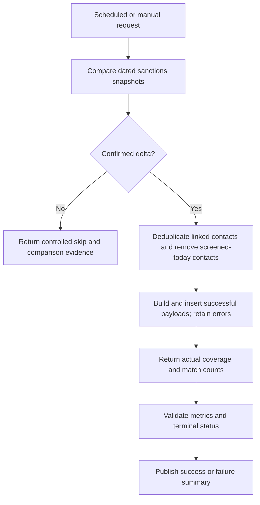

# Daily Screening Run

## Business Purpose
Run the recurring sanctions-screening job for account-linked contacts after checking whether OFAC, UK, and UN backup files changed since the previous calendar day, while also stamping each created screening with a FATF listed-jurisdiction result based on a hardcoded country list. The scheduled job does not necessarily create screening records every day because it exits when all three sanctions files are unchanged.

## Trigger / Frequency
- Trigger: GitHub Actions workflow calls `POST /token` and then `GET /actions/run_screening_process`.
- Frequency: Daily at 14:00 UTC / 8:00 AM Costa Rica time, plus manual workflow dispatch.

## Systems Involved
- `agm-api`
- GitHub Actions
- Supabase-backed `account_contact`, `contact`, and `contact_screening` tables
- Reporting backup used by `get_ibkr_details`
- Sanctions source files managed through the reporting layer

## Roles / Owners
- Primary owner: Andres Aguilar
- Backup owner: Hernan Castro
- Executive oversight: Hernan Castro

## Inputs / Prerequisites
- Current account list from the AGM database
- Latest IBKR details backup
- Current-day and previous-calendar-day sanctions-list backups for OFAC, UK, and UN when available
- Current hardcoded FATF listed-jurisdiction country set used during screening record creation
- Existing contact-screening history
- Working API auth token generated through `/token`

## Step-by-Step Workflow
1. The scheduled GitHub workflow requests an authenticated AGM user token and calls `/actions/run_screening_process`.
2. The API compares today’s sanctions backup files against the previous calendar day through `compare_all_sanctions_today_vs_yesterday`. A snapshot is considered present when a backup filename starts with the expected list name and `YYYYMMDD` date. ETL backup names are generated at the start of each pipeline request in Costa Rica time; they must not be derived from module-import time.
3. If one or more sanctions files are unavailable, the process logs the gap and includes the unavailable-list detail in the returned summary. Without a confirmed positive delta, it exits with a controlled skip instead of screening on incomplete comparison evidence.
4. If all three sanctions lists are available and unchanged, the process exits early and returns a compact “skipped” result.
5. With a confirmed list delta, read account-contact links and screening history, deduplicate linked contact IDs, and remove contacts with a screening already dated today.
6. Record planned/targeted contacts and pre-run historical coverage. Account counts refer to linked accounts represented in the remaining targets; no-history and partial-history counts are measured before this run's inserts.
7. Load contact/account/IBKR context and one set of sanctions indexes through the batch builder. Build the normal screening payload for each target; continue independent targets when one payload fails. Insert the successfully built payloads in bulk.
8. Derive sanctions match counts from those payloads only after the full built batch is confirmed inserted. A per-list count is the number of newly screened contacts with at least one hit in that list, not the number of underlying source rows. With-match and without-match contact counts must sum to inserted screenings. Do not substitute zeros for unavailable metrics.
9. Return actual planned/executed/error counts, coverage, match counts and success/partial/failed status. A zero-target same-day run returns an explicit skipped outcome without inserts. A preview does not claim persistence.
10. The workflow validates the response schema, count invariants and error list. Any screening error, incomplete insert, missing required execution metric or malformed/non-200 response fails the workflow. Controlled skips retain unavailable population/match metrics. The terminal summary is published even on failure; the operation is not automatically replayed.
11. The displayed overview uses readable sentence-case labels for every metric, preserving OFAC / UK / UN capitalization (for example, “Screenings executed”, “Contacts targeted”, and “OFAC matches”), and omits `total_screenings_planned`, `accounts_with_no_screenings_at_all`, `accounts_with_some_contacts_no_screenings`, `screenings_with_list_matches`, and `screenings_without_list_matches`. These metrics remain in the API response and workflow validation; only their display in logs, the step summary and success email is suppressed.

## Workflow Diagram

## Outputs / Records Created
- New `contact_screening` records for in-scope contacts when execution occurs
  Each record can contain FATF status of `Listed` or `null`, plus OFAC / UK / UN screening evidence.
- An API response containing compact OFAC / UK / UN comparison flags (`all_available`, `all_same`) and numeric per-list deltas, plus targeted contacts, executed screenings, contacts with and without OFAC / UK / UN matches, per-list match counts, screening-error contact ids, and any sanctions-availability warnings
- GitHub Actions success or failure email notification

## Exception Paths / Failure Handling
- Sanctions file unavailable: process logs the missing list, includes the unavailable-list detail in the response summary, and skips unless another list has a confirmed positive delta.
- Stale ETL worker date: runtime configuration refreshes date-stamped backup names at pipeline start so long-lived workers cannot reuse an earlier import-time date.
- Token generation failure: GitHub workflow exits before calling the screening route.
- Contact-level screening failure: the API retains the error and continues remaining contacts; the final partial/failed result makes the workflow fail even when HTTP is 200.
- No sanctions changes or all targets already screened today: process exits with a skipped result instead of writing new screenings.

## Controls / Verification Points
- Detective control: process compares current and prior sanctions lists before deciding whether to screen.
- Detective control: process returns sanctions-availability warnings in the summary when one or more required dated backups are missing.
- Detective control: every created screening record evaluates the resolved holder residence country against the maintained FATF listed-jurisdiction country set.
- Detective control: a full same-day duplicate screening run is avoided when every targeted contact already has today’s screening date.
- Current limitation: unchanged sanctions files cause the job to skip before it checks whether new or previously unscreened contacts need coverage.
- Current limitation: sanctions and IBKR data are cached per API worker and are not invalidated by this workflow.

## Evidence to Retain
- GitHub Actions run history for `daily_screening.yaml`
- API logs showing sanctions comparison outcome and run summary
- `contact_screening` records created for the current date
- Success or failure notification email generated by the workflow
- API response summary fields for coverage, sanctions matches, screening-error contact ids, `sanctions_unavailable_lists`, and `summary_messages` when present

## Related Code / Pages / Routes
- Entry surfaces: `agm-api/.github/workflows/daily_screening.yaml`, `agm-api/src/app/tools/private/actions.py`
- Supporting modules: `agm-api/src/components/clients/contacts.py`, `compliance/processes/15b-compliance-reference-data-refresh.md`, `compliance/processes/16-contact-screening-and-aml-risk-assessment.md`
- Downstream side effects: `agm-api/src/components/clients/contacts.py`, `agm-api/src/components/tools/public/reporting.py`

## Last Reviewed
- Status: draft
- Date: 2026-08-03
- Reviewer: Codex current-state code review
