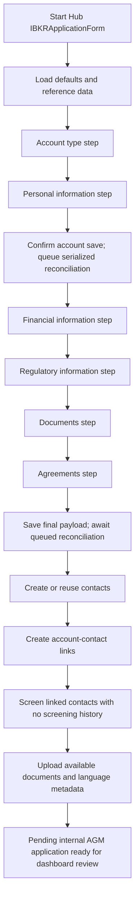

# Account Opening and AGM Account Creation

## Business Purpose
Present bilingual personal and institutional document requirements, capture client account-opening data through the Hub workflow, create the internal AGM account record, create or link related contacts, prepare screening and document context, and store the application payload used for downstream onboarding.

## Trigger / Frequency
- Trigger: Client or operator opens the Hub requirements page or starts the Hub `IBKRApplicationForm`.
- Frequency: On demand.

## Systems Involved
- `agm-hub`
- `agm-api`
- AGM accounts, contacts, account-contact links, and document records
- Hub form schemas and application defaults
- Reference data endpoints for financial ranges, business/occupation types, and IBKR forms

## Roles / Owners
- Primary owner: Andres Aguilar
- Backup owner: Hernan Castro
- Executive oversight: Hernan Castro

## Inputs / Prerequisites
- Valid application schema and default payload
- Reference data from `GetFinancialRanges`, `GetBusinessAndOccupation`, and `GetForms`
- Optional advisor code from the Hub URL
- Advisor code from an Advisor Hub application link, when the advisor shares one
- Applicant personal, financial, regulatory, and document data
- Localized accepted-document guidance for personal and institutional applicants

## Step-by-Step Workflow

### Provider-branded application links

The public application may be opened with `provider_id=<uuid>` (the legacy
`provider`, `application_provider`, and apply-page `id` aliases are also accepted). The Hub
looks up the UUID through the public provider-read API, disables AGM logo
navigation to the index, and applies the provider's validated JSON color
scheme. Without a valid provider record, the normal AGM branding and
navigation remain in effect.

### Advisor application links

In Advisor Hub > Advisor Details, the advisor can select `Copy application link`, choose English or Spanish, preview the URL, and copy it. The URL uses `https://agmtechnology.com/{language}/apply?ad={advisor.code}`. The same action is available to operators from the Dashboard Advisors list. Copying the link does not submit an application or change advisor records; the applicant starts the Hub workflow by opening it. The Advisor Details action remains available when the advisor has no linked contact.

1. The Hub requirements page presents localized personal and institutional document guidance before application, including an income certification by a public or private accountant as an accepted Source-of-Wealth document.
2. The Hub application form loads the application schema defaults and fetches required reference data.
3. The applicant progresses through account type, personal information, financial information, regulatory information, documents, and agreements steps.
4. The form builds an internal application payload that includes account, customer, document, and agreement data.
5. On Personal Info, the workflow confirms creation of the AGM account through `/accounts/create` and stores the application payload before advancing to Financial Info. A synchronous in-flight guard prevents repeated Next clicks from creating overlapping saves. Subsequent steps update the same account.
6. After each confirmed step save, it queues a captured application snapshot for serialized background contact/link/document reconciliation. Personal Info, Financial Info, Regulatory Info and Documents can advance without awaiting reconciliation. Final Agreements waits for all earlier attempts and its own reconciliation before success. A failed attempt is logged and rejected; the next saved step or explicit Documents retry runs a new attempt without overlapping writes in the mounted application.
7. It creates or updates account-contact link records so downstream account and review pages can resolve the account holders.
   Organization applications require a named company contact plus at least one
   associated person, each with a distinct contact and account-contact link.
   The queued reconciliation calls the shared API matcher once with the saved
   account ID. The API reads the authoritative saved application and atomically
   resolves all contacts, records identity and creates/updates links. The
   transaction uses an advisory lock; screening and file uploads stay outside it.
   Person birthdays and multiple government IDs are stored separately from the
   generic contact record, with source-account provenance and an explicit
   applicant-declared verification status. Government IDs are text scoped by
   document type and issuing country, preserving leading zeroes.
   Exact document identity and compatible birthday can reuse a contact even when
   email changes. Email/name alone cannot prove identity. Older contacts require
   existing holder-ID links or independent holder-ID-resolved saved application
   evidence; missing evidence, ambiguity and conflicting populated identity stop
   reconciliation for review without creating another contact to bypass it.
   All holders resolve or the entire contact/identity/link transaction rolls back.
   A company remains separate from its people and receives no personal birthday
   or government ID; company links keep person entity_id null. Existing links
   and document identities are reused without merging or deleting contacts.
8. Documents waits for the latest reconciliation before loading linked holders, with explicit loading, failure and retry states; zero holders is an error. Each reconciliation uploads available supporting files that are not already present by checksum. It reads the saved-file inventory once per holder within that attempt and adds checksums only after confirmed uploads; retries read fresh saved-file evidence and reuse already stored files. It uploads supporting documents, captures declared document language, and preserves document metadata linked to the proper contact context. The contact-document table presents category, type, language, issued date, and expiration date, hides internal ids, displays stored `en`/`es` language codes as `English`/`Spanish`, and formats stored timestamps as localized date-only values.
9. Document uploads store the raw file and metadata without running text extraction or OCR in the API upload flow.
10. When the application is finalized, the Hub reads screening history for each linked contact and calls the contact-screening API only for contacts with no existing screening rows.
11. The created account remains an internal AGM application until it is later submitted to IBKR.

The contact-document upload and edit forms provide separate clear buttons for issue and expiry dates when a date is selected. Clearing resets the field; saving an edit sends null for an empty date to remove the stored value.

### Dashboard pending-application review

Opening the Dashboard review page only reads the saved application and its related records. An explicit contact check, a saved holder edit, or preparing an IBKR submission invokes the shared saved-account matcher with only the account ID under the operator's authenticated API permissions. Holder edits save the application first; if matching then fails, the UI reports that the details were saved and keeps submission blocked pending a successful check. The standalone raw-JSON editor's save handler uses the same helper; that component currently has no mounted page entry point.

Reconciliation refreshes the saved application, confirmed account-contact links, documents context and screening summaries. Old document/screening context is cleared while checking and remains withheld on failure. The Dashboard does not select an existing contact using email/name or invent its own birthday/ID matching policy. Confirmed results are associated with saved holders by their supplied holder identifiers and exact saved names; ambiguous associations stop for review. Company and person contacts remain separate.

Within the mounted review page, an in-flight guard prevents overlapping identity saves/checks and submission attempts. A stale application edit is rejected before saving when its prior payload differs from the current saved payload. Changed account/application data during reconciliation or document preparation blocks the IBKR request. These checks do not constitute a database transaction spanning broker submission. See [IBKR Account Submission and Onboarding](10-ibkr-account-submission-and-onboarding.md).

## Workflow Diagram

## Outputs / Records Created
- Internal AGM account record with stored application payload
- Contact records for the account holders
- Private birthday and government-ID evidence with source-account provenance; these are applicant-declared, not verified identity
- Account-contact relationship records
- Supporting document records and file metadata
- Document language metadata
- Screening records where the workflow triggers them

## Exception Paths / Failure Handling
- Reference-data load failure: form cannot be completed reliably and surfaces an error toast.
- Validation errors: step navigation stops until required fields are corrected.
- Partial reconciliation failure: the account remains saved. English/Spanish Documents guidance distinguishes malformed identity (return to Personal Information and save corrected details), ambiguous/conflicting/insufficient identity (AGM identity review), unavailable/non-pending accounts or authorization problems (AGM support), and temporary setup, document or screening failures (retry). Only retryable failures show a setup retry button; all retain final-success gating. Safe API request references are shown for support without displaying raw upstream identity or errors. The next saved step also queues a fresh attempt. Final success is blocked until reconciliation, screening and available-document upload succeed. Only the latest mounted attempt can set failure feedback or emit a background failure toast; obsolete attempts still reject and retain diagnostic logs. Browser/server error records include account ID, customer type, operation, controlled failure kind and an available safe request reference; the client-log route emits an Error Reporting event. No form payload is added to this reconciliation event.
- Background execution is needed only while the applicant fills the form; tab-closure persistence is outside scope. The API matcher atomically and idempotently resolves contact identity and account links; the browser queue schedules those calls and awaits final completion. No automatic duplicate-contact merge or bulk identity backfill occurs.
- Payload serialization or unsupported-value issues are explicitly checked before critical submission steps.

## Controls / Verification Points

- Preventive control: company and associated-person contacts cannot share one
  resolved contact ID. Repeated completed sync reuses their distinct existing
  links, including people who legitimately share an email. These controls do not
  establish verified identity. The shared API matcher now makes each contact/identity/link reconciliation atomic, while Hub #64 provides serialized background scheduling after each saved step and an awaited final gate. Screening remains at finalization so the financial and regulatory inputs are complete.
- Preventive control: Zod schema validation and step gating reduce malformed application payloads.
- Preventive control: defaults enforce a standard starting shape for tax, financial, and regulatory sections.
- Preventive control: English and Spanish requirement catalogs present the same accepted Source-of-Wealth document options for personal and institutional applicants.
- Detective control: internal account record keeps the raw application payload for downstream review.
- Detective control: linked contacts and documents can be reviewed in Dashboard before IBKR submission.
- Detective control: the Hub document table exposes business-relevant document metadata without displaying internal identifiers or raw timestamp values.

## Evidence to Retain
- Internal account/application payload stored on the account
- Linked contact and account-contact records
- Uploaded document records
- Document language metadata
- Client-side and server-side logs for onboarding failures, with birthday and identification fields redacted
- Private identity tables enable RLS and revoke browser-role access; generic contact reads and matcher responses omit raw identity values

## Related Code / Pages / Routes
- Entry surfaces: `agm-hub/src/components/hub/apply/IBKRApplicationForm.tsx`, `agm-dashboard/src/components/dashboard/clients/advisors/AdvisorsPage.tsx`, and `agm-dashboard/src/components/dashboard/clients/advisors/AdvisorDetailPage.tsx`
- Supporting modules: `agm-hub/src/components/hub/requirements/Requirements.tsx`, `agm-hub/src/components/hub/apply/ContactDocuments.tsx`, `agm-hub/src/app/[lang]/en.json`, `agm-hub/src/app/[lang]/es.json`, `agm-hub/src/utils/clients/application.ts`, `agm-hub/src/utils/clients/account.ts`
- Downstream side effects: account, contact, account-contact, screening, and document APIs; see [Contact Screening and AML Risk Assessment](16-contact-screening-and-aml-risk-assessment.md)

## Last Reviewed
- Status: draft
- Date: 2026-10-21
- Reviewer: Codex application reconciliation review and local validation
