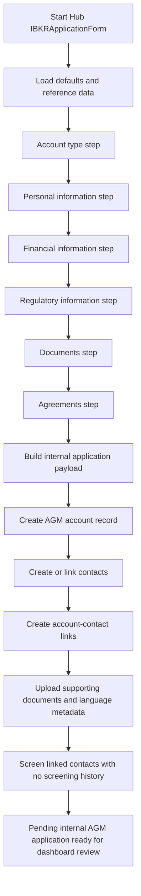

# Account Opening and AGM Account Creation

## Business Purpose
Present bilingual personal and institutional document requirements, capture client account-opening data through the Hub workflow, create the internal AGM account record, create or link related contacts, prepare screening and document context, and store the application payload used for downstream onboarding.

## Trigger / Frequency
- Trigger: Client or operator opens the Hub requirements page or starts the Hub `IBKRApplicationForm`.
- Frequency: On demand.

## Systems Involved
- `agm-hub`
- `agm-api`
- AGM accounts, contacts, account-contact links, and document records
- Hub form schemas and application defaults
- Reference data endpoints for financial ranges, business/occupation types, and IBKR forms

## Roles / Owners
- Primary owner: Andres Aguilar
- Backup owner: Hernan Castro
- Executive oversight: Hernan Castro

## Inputs / Prerequisites
- Valid application schema and default payload
- Reference data from `GetFinancialRanges`, `GetBusinessAndOccupation`, and `GetForms`
- Optional advisor code from the Hub URL
- Advisor code from an Advisor Hub application link, when the advisor shares one
- Applicant personal, financial, regulatory, and document data
- Localized accepted-document guidance for personal and institutional applicants

## Step-by-Step Workflow

### Provider-branded application links

The public application may be opened with `provider_id=<uuid>` (the legacy
`provider`, `application_provider`, and apply-page `id` aliases are also accepted). The Hub
looks up the UUID through the public provider-read API, disables AGM logo
navigation to the index, and applies the provider's validated JSON color
scheme. Without a valid provider record, the normal AGM branding and
navigation remain in effect.

### Advisor application links

In Advisor Hub > Advisor Details, the advisor can select `Copy application link`, choose English or Spanish, preview the URL, and copy it. The URL uses `https://agmtechnology.com/{language}/apply?ad={advisor.code}`. The same action is available to operators from the Dashboard Advisors list. Copying the link does not submit an application or change advisor records; the applicant starts the Hub workflow by opening it. The Advisor Details action remains available when the advisor has no linked contact.

1. The Hub requirements page presents localized personal and institutional document guidance before application, including an income certification by a public or private accountant as an accepted Source-of-Wealth document.
2. The Hub application form loads the application schema defaults and fetches required reference data.
3. The applicant progresses through account type, personal information, financial information, regulatory information, documents, and agreements steps.
4. The form builds an internal application payload that includes account, customer, document, and agreement data.
5. The workflow creates the AGM account record through `/accounts/create` and stores the application payload on the account.
6. It extracts applicant contacts from the application payload and creates or links the contact records needed for the account.
7. It creates or updates account-contact link records so downstream account and review pages can resolve the account holders.
8. It uploads supporting documents, captures declared document language, and preserves document metadata linked to the proper contact context. The contact-document table presents category, type, language, issued date, and expiration date, hides internal ids, displays stored `en`/`es` language codes as `English`/`Spanish`, and formats stored timestamps as localized date-only values.
9. Document uploads commit the raw file/contact association and an OCR attempt, then run Google OCR through the shared API. Upload success depends on saved records; OCR failure remains internal for later recovery.
10. When the application is finalized, the Hub reads screening history for each linked contact and calls the contact-screening API only for contacts with no existing screening rows.
11. The created account remains an internal AGM application until it is later submitted to IBKR.

The contact-document upload and edit forms provide separate clear buttons for issue and expiry dates when a date is selected. Clearing resets the field; saving an edit sends null for an empty date to remove the stored value.

## Workflow Diagram

## Outputs / Records Created
- Internal AGM account record with stored application payload
- Contact records for the account holders
- Account-contact relationship records
- Supporting document records and file metadata
- Document language metadata
- Screening records where the workflow triggers them

## Exception Paths / Failure Handling
- Reference-data load failure: form cannot be completed reliably and surfaces an error toast.
- Validation errors: step navigation stops until required fields are corrected.
- Partial creation failure after account creation: account may exist internally with incomplete linked data and requires operational follow-up.
- Payload serialization or unsupported-value issues are explicitly checked before critical submission steps.

## Controls / Verification Points
- Preventive control: Zod schema validation and step gating reduce malformed application payloads.
- Preventive control: defaults enforce a standard starting shape for tax, financial, and regulatory sections.
- Preventive control: English and Spanish requirement catalogs present the same accepted Source-of-Wealth document options for personal and institutional applicants.
- Detective control: internal account record keeps the raw application payload for downstream review.
- Detective control: linked contacts and documents can be reviewed in Dashboard before IBKR submission.
- Detective control: the Hub document table exposes business-relevant document metadata without displaying internal identifiers or raw timestamp values.

## Evidence to Retain
- Internal account/application payload stored on the account
- Linked contact and account-contact records
- Uploaded document records
- Document language metadata
- Client-side and server-side logs for onboarding failures

## Related Code / Pages / Routes
- Entry surfaces: `agm-hub/src/components/hub/apply/IBKRApplicationForm.tsx`, `agm-dashboard/src/components/dashboard/clients/advisors/AdvisorsPage.tsx`, and `agm-dashboard/src/components/dashboard/clients/advisors/AdvisorDetailPage.tsx`
- Supporting modules: `agm-hub/src/components/hub/requirements/Requirements.tsx`, `agm-hub/src/components/hub/apply/ContactDocuments.tsx`, `agm-hub/src/app/[lang]/en.json`, `agm-hub/src/app/[lang]/es.json`, `agm-hub/src/utils/clients/application.ts`, `agm-hub/src/utils/clients/account.ts`
- Downstream side effects: account, contact, account-contact, screening, and document APIs; see [Contact Screening and AML Risk Assessment](16-contact-screening-and-aml-risk-assessment.md)

## Last Reviewed
- Status: draft
- Date: 2026-07-15
- Reviewer: Codex current-state code review

## Hub Multi-resource Read Batches
Application financial ranges, occupations and agreement forms are fetched concurrently inside one fixed server batch. An in-flight reference prefetch is shared with the form fallback; completed responses are not cached. Document holders are deduplicated by stored contact ID before reads and only id/display name cross the browser boundary. Holder failures have explicit retry and stale/unmounted results are ignored. No generic public API proxy is introduced; existing service scopes, application persistence and submission controls are unchanged.

## Contact Upload OCR and Content Reuse — October 14, 2026
Dashboard Contact Documents, Accounts Audit uploads, Hub Contact Documents and Hub application uploads use the shared `POST /contacts/documents` API. The API verifies SHA-1 against decoded content and atomically reuses/creates the canonical raw `document`, reuses/creates one `contact_document` link per contact/file regardless of account context and claims one `document_processing` `text_extraction` attempt with status `pending`. A PostgreSQL transaction advisory lock by content serializes identical uploads across workers; raw bytes are compared before reuse so a matching checksum alone is insufficient. Existing review metadata and original account context are preserved on repeated upload; the response uses `link_reused=true` when no new contact link is created.

After commit, PDFs and supported raster images run the existing Google Document AI Enterprise OCR provider explicitly; supported plain text uses the shared native text parser. OCR completion stores nonempty text and `completed`; provider/configuration/unsupported-file failures store `failed`. If processing-status persistence fails or the worker stops, the durable pending row remains for later recovery. Upload returns successful `id`/`document_id` once persistence succeeded, regardless of OCR outcome; no OCR warning/error is exposed to the client. Existing completed, failed or pending extraction attempts are reused rather than automatically repeated by upload. Recovery scheduling is outside this change; the existing backfill still selects documents without completed nonempty extraction.

Duplicate responses include `duplicate=true`; interactive upload surfaces show a successful existing-file reuse message. Route authentication and stored caller scopes still authorize writes. Clients cannot select an existing raw document by arbitrary ID/hash: uploaded bytes must match canonical content. Edit/delete sends `contact_document_id` and changes only that selected link. Legacy document-only writes are permitted only when exactly one link exists; ambiguous shared documents return 409. Raw content and its processing rows are deleted only when the last link is removed. Existing broader document-write scope remains unchanged; this is not a new per-client capability system.

Evidence: synthetic Flask/JWT upload and mutation tests, retained completed/failed/pending states, repeated and concurrent identical uploads, hash conflicts, atomic rollback and shared-document edit/delete isolation. Local tests use SQLite transaction serialization and mocked OCR; CI is configured with disposable local PostgreSQL for advisory-lock concurrency. No client documents/provider calls/production writes are used by tests. No schema changes or DDL migration are required.
