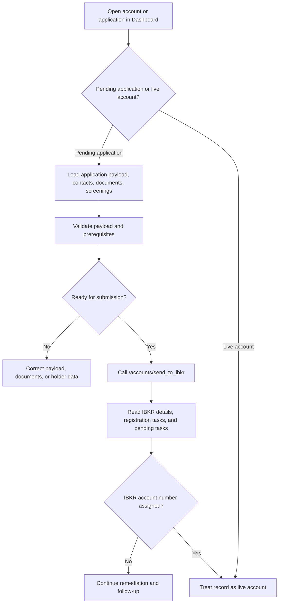

# IBKR Account Submission and Onboarding

## Business Purpose
Move an internally prepared AGM application into the IBKR onboarding process, then monitor and remediate the resulting onboarding state through account details, registration tasks, pending tasks, documents, and related IBKR servicing actions.

## Trigger / Frequency
- Trigger: Operator opens a pending application in Dashboard and chooses to submit it to IBKR.
- Frequency: On demand.

## Systems Involved
- `agm-dashboard`
- `agm-api`
- IBKR onboarding and account-management APIs
- AGM internal account/application data

## Roles / Owners
- Primary owner: Andres Aguilar
- Backup owner: Hernan Castro
- Executive oversight: Hernan Castro

## Inputs / Prerequisites
- Internal AGM account with pending application payload
- Linked documents and holder data required by IBKR
- Chosen `master_account`
- Valid API token and IBKR connectivity

## Step-by-Step Workflow
1. The Dashboard `AccountOrApplicationPage` decides whether the selected record is still a pending application or a live IBKR account.
2. For pending applications, the user works from `ApplicationPage`, which now uses one Dashboard server-side loader to read the stored internal application payload, advisors, financial ranges, and account-contact plus screening summary before hydrating the client page. Its holder edit forms support individual, joint, and organization-associated holders; when employer business or occupation is `OTHER`, the operator must provide `employmentDetails.description` (up to 200 characters), while self-employed holders may provide the separate `businessDescription`. Its contact-document upload and edit forms allow an operator to select a known document type or replace the `Other` option with a required free-text type. The contact-document table shows category, the stored type, language, issued date, and expiration date, hides internal ids, displays stored `en`/`es` language codes as `English`/`Spanish`, and formats stored timestamps as date-only values.
3. The application payload is validated and prepared for IBKR submission. `ApplicationPage` reads the stored files selected for IBKR, blocks submission with a warning that identifies any document larger than 2 MB, and embeds the remaining documents, including their file data and metadata, in `application.documents`. Submission is also blocked if required documents are missing or any prepared document lacks file data or metadata.
4. The operator triggers `/accounts/send_to_ibkr`, passing the AGM account id, selected master account, and application payload.
5. After submission, Dashboard queries `/accounts/ibkr/details` and provides separate Pending Tasks, Registration Tasks, and Login Messages tabs. Each tab loads only when selected. `/accounts/ibkr/pending_tasks` reads IBKR `type=pending` (the approval-specific subset); `/accounts/ibkr/registration_tasks` reads `type=registration` (the full registration-task inventory, including completed and maintenance tasks). The registration read requires both the IBKR account number and master account and uses the existing authenticated API scope controls.
6. Additional onboarding remediation can occur through IBKR document submission, fee template application, trading permissions, CLP capability, and other account-management flows.
7. Before a live-account CLP capability request can be submitted from Dashboard, the account must already show `OPT` investment experience with at least 3 years trading and at least the `11-25` trades-per-year band.
8. Once an IBKR account number exists, the record is treated as an account page rather than a pending application page.

The contact-document upload and edit forms provide separate clear buttons for issue and expiry dates when a date is selected. Clearing resets the field; saving an edit sends null for an empty date to remove the stored value.

Task cards retain the returned state, completion date, warnings, and person/reference identifiers when present. Unknown actions and historical tasks remain visible in Other Tasks and History; both `to send` and `to be sent` are displayed. The Registration Tasks tab uses the existing document-submission flow only for incomplete, non-declined `to sign` tasks with a numeric form number and no questionnaire question IDs, excluding tasks already received or under review. `to complete` tasks direct the operator to IBKR Portal. Completed tasks are never submitted again. Read failures display an error and an explicit Retry control rather than an empty inventory. The account tabs wrap on narrow screens.

The Login Messages tab reads `/accounts/ibkr/login_messages`, which queries Account Management `/gw/api/v1/accounts/{accountId}/login-messages` using the selected account and master credentials. It shows each returned message description, type, state, username, assignment date, message/content IDs, and linked task IDs. It is read-only: outstanding requirements are completed in IBKR Portal. Missing identities, mismatched account responses, provider errors, and contradictory message envelopes fail explicitly with a Retry control; late responses from a previously selected account are ignored. The bulk cross-account login-message feed is not used by this account tab. These tabs do not establish full coverage of master-account compliance obligations or trading notifications. The Accounts Audit compliance indicators still use the separately documented static snapshot (process 22).

## Workflow Diagram

## Outputs / Records Created
- IBKR onboarding submission initiated from AGM
- IBKR detail, registration-task, and pending-task responses used for follow-up
- Updated internal account state as IBKR identifiers and dates become populated

## Exception Paths / Failure Handling
- Centralized API exception reports retain request/error IDs, HTTP method, route template, endpoint, status/code and exception types with stack file/line/function locations. They omit query values, client IPs, error details, exception messages and source-line text; client-facing controlled errors retain their existing message/details. This redaction covers the shared exception wrapper, not every independent integration/audit log.
- Known IBKR request validation and account-access denials retain structured 400/422 or 403 responses without error-level exception logs. Dashboard carries controlled API errors across server actions as data so toast handlers retain the message, validation details, and request id in production. Pending-task failures now reach a toast instead of becoming a null success. Missing CLP documents and rejected document submissions stop before the capability request and preserve the original validation error. Unknown server/configuration failures remain reportable.
- IBKR validation failure: the API returns HTTP 422 with structured validation messages; the application remains pending and must be corrected before retry.
- Other IBKR submission failure: the API returns a gateway failure and the application remains pending for investigation before retry.
- Missing onboarding prerequisites such as documents or malformed payload fields can block submission.
- Registration-task and pending-task read failures prevent monitoring but do not necessarily roll back the submission.

## Controls / Verification Points
- Preventive control: pending-vs-live account branching is determined from account state before rendering the page.
- Preventive control: when the operator sends an application to IBKR, the Dashboard checks the stored documents returned by the API and blocks the request with a warning if any selected document is larger than 2 MB.
- Preventive control: the Dashboard and its IBKR request helper reject submission unless `application.documents` is populated, and the page checks each prepared document for file data and required metadata.
- Preventive control: application payload validation checks run before critical submission.
- Preventive control: the live-account CLP capability action in Dashboard stays disabled unless IBKR account details show `OPT` investment experience with at least 3 years trading and at least `11-25` trades per year.
- Preventive control: choosing `Other` for a categorized contact document requires a nonblank free-text document type before upload or metadata save.
- Preventive control: choosing `OTHER` for employer business or occupation requires a nonblank `employmentDetails.description` before holder details can be saved.
- Detective control: registration and pending tasks provide a post-submission checklist for follow-up.
- Detective control: supporting documents and screenings can be reviewed from the application context before submission.
- Detective control: the Dashboard document table exposes business-relevant metadata without displaying internal identifiers or raw timestamp values.

## Evidence to Retain
- Stored internal application payload on the AGM account
- Submission results and IBKR identifiers
- Registration-task, pending-task, and login-message outputs
- Uploaded supporting documents and holder screening records

## Related Code / Pages / Routes
- Entry surfaces: `agm-dashboard/src/components/dashboard/clients/accounts/AccountOrApplicationPage.tsx`, `agm-dashboard/src/components/dashboard/clients/applications/ApplicationPage.tsx`
- Supporting modules: `agm-dashboard/src/components/dashboard/clients/documents/ContactDocuments.tsx`, `agm-dashboard/src/utils/clients/account.ts`, `agm-dashboard/src/utils/tools/account_pages.ts`
- Downstream side effects: `/accounts/send_to_ibkr`, `/accounts/ibkr/details`, `/accounts/ibkr/registration_tasks`, `/accounts/ibkr/pending_tasks`, `/accounts/ibkr/login_messages`

## Last Reviewed
- Status: draft
- Date: 2026-07-16
- Reviewer: Codex current-state code review
