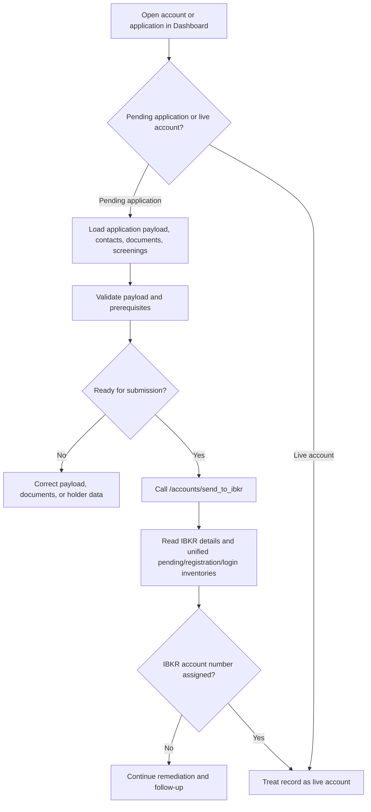

# IBKR Account Submission and Onboarding

## Business Purpose
Move an internally prepared AGM application into the IBKR onboarding process, then monitor and remediate the resulting onboarding state through account details, registration tasks, pending tasks, documents, and related IBKR servicing actions.

## Trigger / Frequency
- Trigger: Operator opens a pending application in Dashboard and chooses to submit it to IBKR.
- Frequency: On demand.

## Systems Involved
- `agm-dashboard`
- `agm-api`
- IBKR onboarding and account-management APIs
- AGM internal account/application data

## Roles / Owners
- Primary owner: Andres Aguilar
- Backup owner: Hernan Castro
- Executive oversight: Hernan Castro

## Inputs / Prerequisites
- Internal AGM account with pending application payload
- Linked documents and holder data required by IBKR
- Chosen `master_account`
- Valid API token and IBKR connectivity

## Step-by-Step Workflow
1. The Dashboard `AccountOrApplicationPage` decides whether the selected record is still a pending application or a live IBKR account.
2. For pending applications, the user works from `ApplicationPage`, which now uses one Dashboard server-side loader to read the stored internal application payload, advisors, financial ranges, and account-contact plus screening summary before hydrating the client page. Its holder edit forms support individual, joint, and organization-associated holders; when employer business or occupation is `OTHER`, the operator must provide `employmentDetails.description` (up to 200 characters), while self-employed holders may provide the separate `businessDescription`. Its contact-document upload and edit forms allow an operator to select a known document type or replace the `Other` option with a required free-text type. The contact-document table shows category, the stored type, language, issued date, and expiration date, hides internal ids, displays stored `en`/`es` language codes as `English`/`Spanish`, and formats stored timestamps as date-only values.
3. The application payload is validated and prepared for IBKR submission. `ApplicationPage` reads the stored files selected for IBKR, blocks submission with a warning that identifies any document larger than 2 MB, and embeds the remaining documents, including their file data and metadata, in `application.documents`. Submission is also blocked if required documents are missing or any prepared document lacks file data or metadata.
4. Before the broker request, Dashboard reconciles the saved pending application through `/contacts/reconcile_application` under the operator's permissions and refreshes confirmed holders, links and screening/document context. Conflicts, ambiguous/insufficient identity, invalid details, denied permissions or failed refresh stop submission with correction/review/retry guidance. Supporting documents are associated using confirmed contact-to-holder mappings, without email matching, fuzzy names or first-holder fallbacks. Same-name holders retain separate document candidates by contact ID. Immediately before `/accounts/send_to_ibkr`, Dashboard rereads the account and stops if the saved application, master, advisor or pending status changed, or the operator navigated to another review page. The broker request receives the refreshed AGM account id, selected master and prepared application payload. This is a client-side workflow gate; it does not create an atomic database/broker transaction or change the separate manual-account completion flow.
5. After submission, Dashboard queries `/accounts/ibkr/details` and provides one Tasks tab for pending, registration and login requirements. The tab loads all three inventories independently only when first opened and retains data, filters and signing receipts across tab switches. After a submission the three feeds reload; a source-specific Retry rereads only the failed source. `/accounts/ibkr/pending_tasks` reads IBKR `type=pending` (the approval-specific subset); `/accounts/ibkr/registration_tasks` reads `type=registration` (the full registration-task inventory, including completed and maintenance tasks). The registration read requires both the IBKR account number and master account and uses the existing authenticated API scope controls.
6. Additional onboarding remediation can occur through IBKR document submission, fee template application, trading permissions, CLP capability, and other account-management flows.
7. Before a live-account CLP capability request can be submitted from Dashboard, the account must already show `OPT` investment experience with at least 3 years trading and at least the `11-25` trades-per-year band.
8. Once an IBKR account number exists, the record is treated as an account page rather than a pending application page.

The contact-document upload and edit forms provide separate clear buttons for issue and expiry dates when a date is selected. Clearing resets the field; saving an edit sends null for an empty date to remove the stored value.

The Tasks workspace retains every returned task/person instance, state, completion date, warning, approval/trading flag, questionnaire identifier and reference internally for reconciliation and signing safeguards. Pending and registration records merge only when task number, entity/person and form number match; the original source records remain inspectable through the info icon in the Details column on hover, keyboard focus or tap. Person/username and date metadata remain in these details rather than separate table columns. A shared form number alone never merges requirements. The shared Dashboard DataTable provides source and status filters while preserving the combined inventory order. There are no search, manual refresh, reset or sorting controls. The status filter offers Pending, Completed and All, starting with Pending for each account. Pending includes every task not confirmed completed, including submissions awaiting IBKR confirmation and unfamiliar actions. Completed shows completed history and All shows both groups. Source counts and the total reflect the selected status group before source filtering. After the feeds refresh, tasks confirmed completed move from Pending to Completed. Status/source changes reuse the loaded inventories and filters persist across tab switches. The table scrolls within its container on small screens.

Operators can sign an individual eligible form or bulk-sign eligible form rows in the current source/status-filtered view. Bulk signing does not follow login-message links to form rows hidden by the filters; individual linked-form signing remains available. Each form number is submitted once per action using the account's existing signature names, linked holder names or account title through the existing document-submission flow. The restored legacy eligibility accepts Pending `to sign` and numeric `to complete` tasks; Registration still requires explicit `to sign`. Both require a positive integer form number and no questionnaire IDs. A Pending completion record without questionnaire IDs is eligible under this legacy rule, even when its name describes a questionnaire or funding notification; a numeric form number does not establish that IBKR will accept the submission. Completed, declined, received/processing/under-review tasks and tasks carrying questionnaire IDs cannot be signed; a completed registration record cannot be bypassed through its pending-feed duplicate. A different completed historical instance of the same form remains available in Completed and All without blocking a new actionable task.

All three inventories must load successfully before signing is available. Feed errors show explicit source-specific Retry controls and preserve other available sources. As in the previous bulk flow, forms are downloaded individually and prepared documents are submitted in batches of up to 10 with one shared signature timestamp per action. A failed form download does not discard other prepared forms or later batches. An explicit IBKR `Accepted`/`ACCEPTED` document result, normalized for case and surrounding whitespace, is required for a success receipt. Numbered results are matched to their submitted form; legacy results without form numbers are matched by order only when the entire batch result list is present and unnumbered. Mixed or partial results leave unconfirmed forms requiring status review. Accepted submission is shown as Submitted while awaiting the task feed's completion update; it is not presented as a completed task. Missing, mismatched or uncertain submission results and transport errors stop later batches and mark unconfirmed forms in the attempted batch for status review. Explicit per-document rejections remain failures and allow later batches to proceed. Accepted/uncertain forms cannot be automatically submitted again within the mounted account workspace. After any attempted submission the three feeds refresh, without replaying writes. Account/master changes or unmount cancel pending preparations and ignore stale read results; a write already sent still belongs to its captured account.

Login messages use `/accounts/ibkr/login_messages`, querying Account Management `/gw/api/v1/accounts/{accountId}/login-messages` with the selected account and master credentials. Descriptions, types, state, username, assignment date, message/content IDs and linked task IDs remain visible. Exact linked task IDs can expose an eligible linked form's signature action within the same table, including the Login source filter. Ambiguous linked task/person matches do not expose a direct signature action. Message/content IDs are never treated as form numbers. Signing a linked document does not assert that the login message itself was acknowledged or completed. Other login requirements direct the operator to IBKR Portal; no tax-update, questionnaire-answer or general login-message completion endpoint is added. Missing identities, account-response mismatches and provider errors fail explicitly. The bulk cross-account login feed and static Accounts Audit indicators remain outside this workspace; the latter are documented in process 22. The table does not establish complete master-account compliance coverage.

## Workflow Diagram

## Outputs / Records Created
- IBKR onboarding submission initiated from AGM
- IBKR detail, registration-task, and pending-task responses used for follow-up
- Updated internal account state as IBKR identifiers and dates become populated

## Exception Paths / Failure Handling
- Centralized API exception reports retain request/error IDs, HTTP method, route template, endpoint, status/code and exception types with stack file/line/function locations. They omit query values, client IPs, error details, exception messages and source-line text; client-facing controlled errors retain their existing message/details. This redaction covers the shared exception wrapper, not every independent integration/audit log.
- Known IBKR request validation and account-access denials retain structured 400/422 or 403 responses without error-level exception logs. Dashboard carries controlled API errors across server actions as data so toast handlers retain the message, validation details, and request id in production. Pending-task failures now reach a toast instead of becoming a null success. Missing CLP documents and rejected document submissions stop before the capability request and preserve the original validation error. Unknown server/configuration failures remain reportable.
- IBKR validation failure: the API returns HTTP 422 with structured validation messages; the application remains pending and must be corrected before retry.
- Other IBKR submission failure: the API returns a gateway failure and the application remains pending for investigation before retry.
- Missing onboarding prerequisites such as documents or malformed payload fields can block submission.
- Registration-task and pending-task read failures prevent monitoring but do not necessarily roll back the submission.

## Controls / Verification Points
- Preventive control: opening review is read-only; explicit contact checks, holder/raw-JSON saves and submission preparation use the shared server matcher. Saved edits remain saved when matching fails, but submission remains blocked. Only confirmed holder mappings enter the refreshed document context; stale context is withheld on failure. Rapid submission/check/save attempts cannot overlap within the mounted page. The standalone raw-JSON editor uses the same save helper but currently has no mounted page entry point.
- Preventive control: contact reconciliation and document preparation must use an unchanged saved application; account status/master/advisor and application payload are checked again before the broker boundary. Cross-session transactional submission remains outside these client checks.
- Preventive control: pending-vs-live account branching is determined from account state before rendering the page.
- Preventive control: when the operator sends an application to IBKR, the Dashboard checks the stored documents returned by the API and blocks the request with a warning if any selected document is larger than 2 MB.
- Preventive control: the Dashboard and its IBKR request helper reject submission unless `application.documents` is populated, and the page checks each prepared document for file data and required metadata.
- Preventive control: application payload validation checks run before critical submission.
- Preventive control: the live-account CLP capability action in Dashboard stays disabled unless IBKR account details show `OPT` investment experience with at least 3 years trading and at least `11-25` trades per year.
- Preventive control: choosing `Other` for a categorized contact document requires a nonblank free-text document type before upload or metadata save.
- Preventive control: choosing `OTHER` for employer business or occupation requires a nonblank `employmentDetails.description` before holder details can be saved.
- Detective control: registration and pending tasks provide a post-submission checklist for follow-up.
- Detective control: supporting documents and screenings can be reviewed from the application context before submission.
- Detective control: the Dashboard document table exposes business-relevant metadata without displaying internal identifiers or raw timestamp values.

## Evidence to Retain
- Stored internal application payload on the AGM account
- Submission results and IBKR identifiers
- Registration-task, pending-task, and login-message outputs
- Uploaded supporting documents and holder screening records

## Related Code / Pages / Routes
- Entry surfaces: `agm-dashboard/src/components/dashboard/clients/accounts/AccountOrApplicationPage.tsx`, `agm-dashboard/src/components/dashboard/clients/applications/ApplicationPage.tsx`
- Supporting modules: `agm-dashboard/src/components/dashboard/clients/documents/ContactDocuments.tsx`, `agm-dashboard/src/utils/clients/account.ts`, `agm-dashboard/src/utils/tools/account_pages.ts`
- Downstream side effects: `/accounts/send_to_ibkr`, `/accounts/ibkr/details`, `/accounts/ibkr/registration_tasks`, `/accounts/ibkr/pending_tasks`, `/accounts/ibkr/login_messages`

## Last Reviewed
- Status: draft
- Date: 2026-10-21
- Reviewer: Codex pending-application identity review integration
