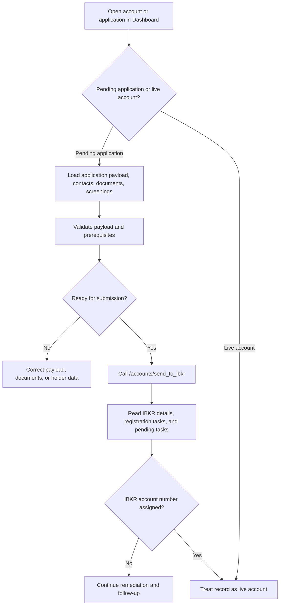

# IBKR Account Submission and Onboarding

## Business Purpose

For profile corrections after broker submission, see [IBKR Account Holder Profile Maintenance](36-ibkr-account-holder-profile-maintenance.md). The account editor supports Individual/Joint holders on open accounts or pending accounts with IBKR task 9974, uses fresh broker details, and preserves submitted-versus-applied status. This does not replace the local application-holder editor used before submission.
Move an internally prepared AGM application into the IBKR onboarding process, then monitor and remediate the resulting onboarding state through account details, registration tasks, pending tasks, documents, and related IBKR servicing actions.

## Trigger / Frequency
- Trigger: Operator opens a pending application in Dashboard and chooses to submit it to IBKR.
- Frequency: On demand.

## Systems Involved
- `agm-dashboard`
- `agm-api`
- IBKR onboarding and account-management APIs
- AGM internal account/application data

## Roles / Owners
- Primary owner: Andres Aguilar
- Backup owner: Hernan Castro
- Executive oversight: Hernan Castro

## Inputs / Prerequisites
- Internal AGM account with pending application payload
- Linked documents and holder data required by IBKR
- Chosen `master_account`
- Valid API token and IBKR connectivity

## Step-by-Step Workflow
1. The Dashboard `AccountOrApplicationPage` decides whether the selected record is still a pending application or a live IBKR account.
2. For pending applications, the user works from `ApplicationPage`, which now uses one Dashboard server-side loader to read the stored internal application payload, advisors, financial ranges, and account-contact plus screening summary before hydrating the client page. Its holder edit forms support individual, joint, and organization-associated holders; when employer business or occupation is `OTHER`, the operator must provide `employmentDetails.description` (up to 200 characters), while self-employed holders may provide the separate `businessDescription`. Its contact-document upload and edit forms allow an operator to select a known document type or replace the `Other` option with a required free-text type. The contact-document table shows category, the stored type, language, issued date, and expiration date, hides internal ids, displays stored `en`/`es` language codes as `English`/`Spanish`, and formats stored timestamps as date-only values.
3. The application payload is validated and prepared for IBKR submission. `ApplicationPage` reads the stored files selected for IBKR, blocks submission with a warning that identifies any document larger than 2 MB, and embeds the remaining documents, including their file data and metadata, in `application.documents`. Submission is also blocked if required documents are missing or any prepared document lacks file data or metadata.
4. The operator triggers `/accounts/send_to_ibkr`, passing the AGM account id, selected master account, and application payload.
5. After submission, Dashboard can query `/accounts/ibkr/details`, `/accounts/ibkr/registration_tasks`, and `/accounts/ibkr/pending_tasks` to follow the onboarding state.
6. Additional onboarding remediation can occur through IBKR document submission, fee template application, trading permissions, CLP capability, and other account-management flows.
7. Before a live-account CLP capability request can be submitted from Dashboard, the account must already show `OPT` investment experience with at least 3 years trading and at least the `11-25` trades-per-year band.
8. Once an IBKR account number exists, the record is treated as an account page rather than a pending application page.

The contact-document upload and edit forms provide separate clear buttons for issue and expiry dates when a date is selected. Clearing resets the field; saving an edit sends null for an empty date to remove the stored value.

## Workflow Diagram

## Outputs / Records Created
- IBKR onboarding submission initiated from AGM
- IBKR detail, registration-task, and pending-task responses used for follow-up
- Updated internal account state as IBKR identifiers and dates become populated

## Exception Paths / Failure Handling
- Nested API functions propagate one ServiceError instance without reporting intermediate failures. Unexpected Python exceptions are normalized once to the generic API failure; final route/Flask or outermost direct-job boundaries handle that failure. The final exception excludes intermediate cause/context chains while retaining correlation IDs, operation/route template, status/code and frame locations without source text. Client-facing controlled errors retain their existing message/details; their final message remains in the diagnostic, while unexpected provider/cause messages are not copied into it. Query values, client IPs and error details remain excluded. This governs shared exception propagation; independent integration/audit logs retain their existing behavior.
- Known IBKR request validation and account-access denials retain structured 400/422 or 403 responses without error-level exception logs. Dashboard carries controlled API errors across server actions as data so toast handlers retain the message, validation details, and request id in production. Pending-task failures now reach a toast instead of becoming a null success. Missing CLP documents and rejected document submissions stop before the capability request and preserve the original validation error. Unknown server/configuration failures remain reportable.
- IBKR validation failure: the API returns HTTP 422 with structured validation messages; the application remains pending and must be corrected before retry.
- Other IBKR submission failure: the API returns a gateway failure and the application remains pending for investigation before retry.
- Missing onboarding prerequisites such as documents or malformed payload fields can block submission.
- Registration-task and pending-task read failures prevent monitoring but do not necessarily roll back the submission.

## Controls / Verification Points
- Preventive control: pending-vs-live account branching is determined from account state before rendering the page.
- Preventive control: when the operator sends an application to IBKR, the Dashboard checks the stored documents returned by the API and blocks the request with a warning if any selected document is larger than 2 MB.
- Preventive control: the Dashboard and its IBKR request helper reject submission unless `application.documents` is populated, and the page checks each prepared document for file data and required metadata.
- Preventive control: application payload validation checks run before critical submission.
- Preventive control: the live-account CLP capability action in Dashboard stays disabled unless IBKR account details show `OPT` investment experience with at least 3 years trading and at least `11-25` trades per year.
- Preventive control: choosing `Other` for a categorized contact document requires a nonblank free-text document type before upload or metadata save.
- Preventive control: choosing `OTHER` for employer business or occupation requires a nonblank `employmentDetails.description` before holder details can be saved.
- Detective control: registration and pending tasks provide a post-submission checklist for follow-up.
- Detective control: supporting documents and screenings can be reviewed from the application context before submission.
- Detective control: the Dashboard document table exposes business-relevant metadata without displaying internal identifiers or raw timestamp values.

## Evidence to Retain
- Stored internal application payload on the AGM account
- Submission results and IBKR identifiers
- Registration-task and pending-task outputs
- Uploaded supporting documents and holder screening records

## Related Code / Pages / Routes
- Entry surfaces: `agm-dashboard/src/components/dashboard/clients/accounts/AccountOrApplicationPage.tsx`, `agm-dashboard/src/components/dashboard/clients/applications/ApplicationPage.tsx`
- Supporting modules: `agm-dashboard/src/components/dashboard/clients/documents/ContactDocuments.tsx`, `agm-dashboard/src/utils/clients/account.ts`, `agm-dashboard/src/utils/tools/account_pages.ts`
- Downstream side effects: `/accounts/send_to_ibkr`, `/accounts/ibkr/details`, `/accounts/ibkr/registration_tasks`, `/accounts/ibkr/pending_tasks`

## Last Reviewed
- Status: draft
- Date: 2026-07-16
- Reviewer: Codex current-state code review

## Contact Upload OCR and Content Reuse — October 14, 2026
Dashboard Contact Documents, Accounts Audit uploads, Hub Contact Documents and Hub application uploads use the shared `POST /contacts/documents` API. The API verifies SHA-1 against decoded content and atomically reuses/creates the canonical raw `document`, reuses/creates one `contact_document` link per contact/file regardless of account context and claims one `document_processing` `text_extraction` attempt with status `pending`. A PostgreSQL transaction advisory lock by content serializes identical uploads across workers; raw bytes are compared before reuse so a matching checksum alone is insufficient. Existing review metadata and original account context are preserved on repeated upload; the response uses `link_reused=true` when no new contact link is created.

After commit, PDFs and supported raster images run the existing Google Document AI Enterprise OCR provider explicitly; supported plain text uses the shared native text parser. OCR completion stores nonempty text and `completed`; provider/configuration/unsupported-file failures store `failed`. If processing-status persistence fails or the worker stops, the durable pending row remains for later recovery. Upload returns successful `id`/`document_id` once persistence succeeded, regardless of OCR outcome; no OCR warning/error is exposed to the client. Existing completed, failed or pending extraction attempts are reused rather than automatically repeated by upload. Recovery scheduling is outside this change; the existing backfill still selects documents without completed nonempty extraction.

Duplicate responses include `duplicate=true`; interactive upload surfaces show a successful existing-file reuse message. Route authentication and stored caller scopes still authorize writes. Clients cannot select an existing raw document by arbitrary ID/hash: uploaded bytes must match canonical content. Edit/delete sends `contact_document_id` and changes only that selected link. Legacy document-only writes are permitted only when exactly one link exists; ambiguous shared documents return 409. Raw content and its processing rows are deleted only when the last link is removed. Existing broader document-write scope remains unchanged; this is not a new per-client capability system.

Evidence: synthetic Flask/JWT upload and mutation tests, retained completed/failed/pending states, repeated and concurrent identical uploads, hash conflicts, atomic rollback and shared-document edit/delete isolation. Local tests use SQLite transaction serialization and mocked OCR; CI is configured with disposable local PostgreSQL for advisory-lock concurrency. No client documents/provider calls/production writes are used by tests. No schema changes or DDL migration are required.

## Daily Agreement Preload — Local Validation, October 14, 2026
The connector's `submit_all_agreements` can prepare the configured 24 English agreement/disclosure PDFs for the IBKR daily `processDocuments` endpoint. This is distinct from per-account pending tasks and customer signatures. It requires an explicit master account. Tax form5001 remains per application. Preparation verifies returned form number, exact filename, PDF header, decoded length/SHA and file/request limits. Incomplete preparation aborts the whole batch before submission. `dry_run=True` performs real form reads and validation but never signs/posts the daily submission and never reports acceptance.

Only one explicit per-form provider outcome can establish acceptance; absent, missing or conflicting outcomes remain unconfirmed. The daily agreement POST has a bounded timeout and is excluded from automatic retry because a timeout can leave acceptance unknown. Logs do not retain PDF payload prefixes. The owner authorized the actual daily PDF upload on October 14. POST /actions/submit_daily_agreements invokes the connector with dry_run=False; the separate preparation route retains dry_run=True. The daily_agreements.yaml workflow calls the submission route at 11:00 UTC (05:00 Costa Rica) for I6413690; manual dispatch can select F10740574. It authenticates through the existing AGM API secrets and enforces API user scope. Success requires all 24 configured forms to have explicit successful IBKR outcomes; HTTP 200 alone is insufficient. Concurrency serializes runs and no workflow submission retries are configured. GitHub Actions retains the final per-form summary and run URL and sends standard success/failure emails from aa@agmtechnology.com to cr@agmtechnology.com and as@agmtechnology.com. Interrupted or timed-out submissions have unknown acceptance and require inspection before manual replay. The preparation workflow was already published; this live upgrade must pass CI and deploy its API route before execution. Hosted broker acceptance and any application-level per-master/day acceptance gate remain unverified. Existing application submission continues including its own agreement PDFs.

Live read-only primary-master check returned24 valid PDFs and no usable PDF for configured9902. All valid returned files matched filenames, lengths and SHA; aggregate PDF bytes6702357. This is download/preparation evidence, not upload acceptance. The owner explicitly excluded9902 from the daily preload list on October14; the remaining24 forms are unchanged. This exclusion does not establish whether9902 is mandatory for an individual client. Keep coordinated Hub72/API197 open until a runner with per-master/day evidence exists and explicit broker acceptance is verified. No daily agreement submission was performed by this validation.
