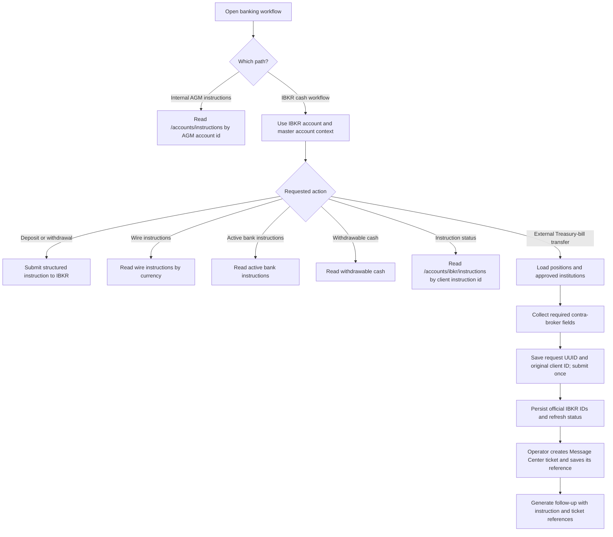

# Account Banking Instructions Handling

## Business Purpose
Maintain two related but distinct banking-instruction workflows: internal AGM banking instructions stored in the database, and IBKR cash-instruction status and cash-availability actions used for deposits, withdrawals, and transfer execution.

## Trigger / Frequency
- Trigger: Operator opens account banking functions in Dashboard or Hub.
- Frequency: On demand.

## Systems Involved
- `agm-dashboard`
- `agm-hub`
- `agm-api`
- AGM internal account-instruction records
- IBKR bank-instruction and cash-operation APIs

## Roles / Owners
- Primary owner: Andres Aguilar
- Backup owner: Hernan Castro
- Executive oversight: Hernan Castro

## Inputs / Prerequisites
- AGM account id
- IBKR account id and master account where required
- Internal stored banking instructions when using `/accounts/instructions`
- Client instruction id when checking IBKR instruction status
- The external-transfer institution selector reads the IBKR enumeration's `brokers` array (`instructionType: COMPLEX_ASSET_TRANSFER`) using an OAuth token with `enumerations.read`. The legacy `jsonData` shape remains supported. The selector includes case-insensitive institution search, a no-matches message and keyboard selection; selecting a result retains its exact IBKR name. A successful list is reused within Account Banking; closing and reopening the dialog retries a failed or empty read.
- For an external Treasury-bill transfer: selected position quantities, receiving account type, approved broker/custodian, receiving account number, institution country, contact email, contact phone, trade date, settlement date, and the receiving custodian’s confirmed settlement-place BIC (8 or 11 characters)

## Step-by-Step Workflow
1. Internal banking instructions are read through `/accounts/instructions` using the AGM account id.
2. These internal instructions provide stored banking context maintained in the AGM database.
3. Separately, IBKR cash workflows use the IBKR-specific routes to create deposit or withdrawal instructions and to request wire instructions, active bank instructions, withdrawable cash, or current instruction status.
4. Deposit and withdrawal actions send a structured `instruction` payload to IBKR with the selected account and master account context.
5. Wire instructions are fetched for the account and requested currency.
6. Active bank instructions and withdrawable cash are read using the client instruction id and account context. Account Banking exposes the already-fetched USD deposit wire details, active WIRE bank instructions and withdrawable amounts by currency in compact informational cards. Operators can hover, focus or tap the corresponding labels; opening a card does not fetch again or submit an instruction. Each card distinguishes loading, no returned data and a failed read.
7. IBKR instruction status is checked through `/accounts/ibkr/instructions` for an existing client instruction id and the account's master account.
8. External Treasury-bill submission is wired in source; deployment and live acceptance are pending at the owner’s request. The earlier Dashboard generated only local references/drafts despite this manual describing signed submission. The new path below reconciles that mismatch after migration and deployment.
9. Dashboard requests positions only when the operator opens the external-transfer modal, and refreshes them on each opening. Opening Account Banking does not request positions or saved external transfers; the saved-transfer history section has been removed. The modal displays all returned account positions; only BILL holdings with a positive quantity can be selected or have transfer quantities edited. Other positions remain visible with disabled controls. Dashboard collects recipient, trade/settlement dates and the confirmed settlement-place BIC without descriptive/example text-input placeholders. The operator reviews and explicitly chooses Submit transfer to IBKR. No QA sample values are prefilled.
10. `/accounts/ibkr/external_asset_transfer` receives the AGM account UUID and a stable request UUID. API derives the IBKR account and supported master from the stored account, validates the request, and rechecks asset type, currency and available quantity against IBKR holdings. An unsupported master cannot fall back to a default. Selected quantities use the units returned by the IBKR position service; do not relabel them as face value without independent verification.
11. Before calling the broker, persist `external_asset_transfer` with a database-sequenced client instruction ID and the immutable submitted business details. Send one signed `POST /gw/api/v2/external-asset-transfers` using COMPLEX_ASSET_TRANSFER / OUT, positions[], contraBrokerInfo and nonDisclosedDetail (tradeDate, settleDate, psetBic). The same request UUID cannot issue a second broker POST, including concurrent requests. An uncertain result stays UNKNOWN/SUBMITTING for status recovery; never automatically resubmit.
12. Save official instructionId, instructionSetId and clientInstructionId separately. `/accounts/ibkr/external_asset_transfers` remains available to read saved account records, but Account Banking does not call it, including after submission or status/ticket updates. The modal uses the returned current-transfer record. The explicit status action calls `/accounts/ibkr/external_asset_transfer/status`, which queries IBKR using the saved instructionId, or the original clientInstructionId when the POST response was lost. Enrich the same record with ibReferenceId, status, clearing state, errors and timestamp. PROCESSED is not settlement; only explicit SETTLED clearing state marks settlement verified.
13. Generate the Message Center ticket draft from the saved official instruction and business details. An operator submits the ticket in IBKR Portal and records the exact assigned ticket reference as text through `/accounts/ibkr/external_asset_transfer/ticket`. Save optional portal transfer reference, ticket link, actual ticket creation time when known, and BMO delivery acceptance. The capture timestamp is separate from actual ticket creation time.
14. Generate/copy the ProServe follow-up only after both official instructionId and Message Center ticket reference are saved. Include account and ibReferenceId when available. The system does not submit tickets or send emails. Use verified ProServe recipients. Coordinate the account-specific T+1 / stated 10 EST clearing cutoff and receiving-broker acceptance of delivery from BMO separately; confirm API/portal instruction equivalence and timezone convention with IBKR before operational use.

## Workflow Diagram

## Outputs / Records Created
- Internal AGM banking-instruction reads
- IBKR deposit or withdrawal instructions
- IBKR wire-instruction, active-bank-instruction, withdrawable-cash, and status responses
- External transfer request snapshot, original client instruction ID, official instruction/set/transaction references, status/clearing state, last error, submitted/updated timestamps, and independently assigned ticket reference/link in `external_asset_transfer`

## Exception Paths / Failure Handling
- Centralized API exception reports retain request/error IDs, HTTP method, route template, endpoint, status/code and exception types with stack file/line/function locations. They omit query values, client IPs, error details, exception messages and source-line text; client-facing controlled errors retain their existing message/details. This redaction covers the shared exception wrapper, not every independent integration/audit log.
- Known IBKR validation and account-access failures return actionable structured 4xx responses. Expired trading sessions return 409 with reconnect guidance. Dashboard preserves these messages for its existing toast handlers without error-level logging. Unexpected upstream, service-credential, and configuration failures remain reportable; failed actions are not converted to successful empty results.
- Missing internal banking-instruction record: internal route returns an empty or partial result set.
- Missing `client_instruction_id` or `master_account`: IBKR instruction-status route returns a 400 error.
- IBKR status responses with HTTP 208 are processed using the returned instruction-result payload.
- Missing account or master account context for IBKR calls: API returns validation errors.
- IBKR-side failures prevent instruction creation or lookup and require operator follow-up.
- External transfer submission is blocked until a valid BILL position and quantity, recipient, dates and confirmed BIC are supplied. TEST is a QA placeholder and fails the production form’s structural BIC validation; syntactic validity alone does not verify settlement instructions.
- If the initial response is lost or unverified, preserve the original request/client identity and use status recovery. No automatic broker POST retry. Do not create a new transfer merely because a status lookup returns not found immediately.
- Apply the migration before deploying the new API and Dashboard. Submission requires durable persistence before the broker POST; missing schema/persistence failures must prevent broker submission. The modal no longer uses saved-transfer history availability or historical pending records as a submission gate. An uncertain current submission still blocks another attempt in the mounted Account Banking view and retains its request UUID for review.
- Exact route scopes (or existing accounts/all operator scope) are enforced server-side. `accounts/read` cannot submit, refresh or save ticket records.

## Temporary UI Preview — October 20, 2026
- Updated October 21: the external-transfer dialog has four separate steps: Submission; Transfer details and ticket draft; Ticket reference and creation time; Email to IBKR. The detail/draft and email steps use the same plain background as Submission, without an orange panel.
- Operators click “Submitted in IBKR — Next” after creating the ticket in Message Center to unlock its metadata step. Only ticket reference and creation time are shown, both required before Save and continue opens the email. Ticket link, alternate portal reference and BMO acceptance inputs are removed from this wizard; existing stored values and the separate operational BMO requirement remain unchanged.
- Temporary “Skip submission — preview ticket” and “Skip ticket — preview email” buttons allow review without completing required fields or creating a transfer/ticket. The second skip is offered on the metadata step after Next, and always uses local preview data. Preview state is held only in the dialog, uses numeric example references in the production display format, and never updates real transfer records.
- Updated October 21: the preview uses normal Transfer details / Official instruction ID labels, PENDING status, ISO timestamps and the same ticket/email formatter as the operational flow. A compact Preview badge identifies the UI state; explanatory sample wording is not inserted into draft content. Entered account/receiver/position details are retained; missing positions remain explicit rather than inventing a security. Broker status refresh and server-side ticket persistence are unavailable in preview; Save and continue keeps preview reference/time in local state only; returning to the Submission screen in preview cannot submit. Back to submission or close/reopen restores normal controls and validation. Real response/ticket requirements remain enforced for the operational flow.

## Controls / Verification Points
- Preventive control: internal and external banking flows are separated by route and data source.
- Preventive control: IBKR status and cash-availability routes validate required identifiers before calling downstream services.
- Detective control: operators can compare stored AGM banking instructions against current IBKR instruction status and active bank instructions.

## Evidence to Retain
- Internal banking-instruction records
- Immutable external request business details and allowlisted response references/status/error fields; never persist signing keys, bearer tokens or signed JWTs
- Wire-instruction and withdrawable-cash outputs used for the client operation

## Related Code / Pages / Routes
- Entry surfaces: `agm-dashboard/src/utils/clients/account.ts`, `agm-hub/src/utils/clients/account.ts`
- Supporting modules: `agm-api/src/app/clients/accounts.py`
- Downstream side effects: `/accounts/instructions`, `/accounts/ibkr/instructions`, `/accounts/ibkr/active_bank_instructions`, `/accounts/ibkr/withdrawable_cash`, `/accounts/ibkr/wire_instructions`, `/accounts/ibkr/deposit`, `/accounts/ibkr/withdraw`, `/accounts/ibkr/positions`, `/accounts/ibkr/complex_asset_transfer_brokers`, `/accounts/ibkr/external_asset_transfer`, `/accounts/ibkr/external_asset_transfers`, `/accounts/ibkr/external_asset_transfer/status`, `/accounts/ibkr/external_asset_transfer/ticket`

## Last Reviewed
- Status: draft
- Date: 2026-10-16
- Reviewer: Codex; source wiring only, not deployed or live-tested
